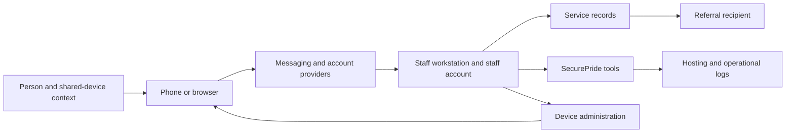

# SecurePride threat model: disclosure, coercion, and continuity of care

Version 0.1 · 21 October 2026 · Proposed, unvalidated

## Objective and scope

Reduce involuntary disclosure, coercive use of information, compromise of support networks, and interruption of care while preserving agency and access to services. Protect a person who never chose the software but whose information flows through it.

Initial scope: adult individuals, peer outreach, appointment coordination, referrals, staff devices, and communication with HIV and LGBTQ+ services. Jurisdiction-neutral scenarios are provisional. Local legal duties, minors and guardianship, clinical safety, surveillance powers, cross-border travel, and emergency response need dedicated review before deployment in those contexts. Their omission is an unresolved deployment boundary, not evidence of low risk.

Threat scenarios describe possible failures. They are not prevalence estimates, allegations about SecurePride, or inferences about an individual's identity or health.

## Contribution hypothesis

Existing guidance covers security planning, privacy threats, community risk and HIV confidentiality. This model proposes a maintained, testable bridge among those bodies of work: each recommendation must identify who benefits, who may be harmed, prerequisites, evidence, care fallback, and a concrete failure test. The package does not claim a new general threat taxonomy or that no comparable work exists. See PRIOR-WORK.md.

## Core modeling unit

Actor with a specified capability → access or observation → exposed fact or inferred association → person bearing the consequence → harm → intervention → intervention's possible harm → test → residual risk.

Three distinctions are mandatory:

- **Actual fact versus hostile inference.** A clinic visit may be misinterpreted. Harm can occur even when the inferred status is false.
- **Authority versus legitimacy.** A staff account may be authorized to read a record and still misuse it. A technically valid disclosure can violate a person's expectations or expose them to harm.
- **Configuration versus protection.** A control being enabled is not evidence that it addresses the relevant scenario. A negative scan is not proof of absence.

## Assets and affected parties

Protect clinical information; identity and contact details; relationships and referrals; appointments, location and communication timing; recovery paths; and the ability to continue obtaining care. Model clients, partners, peers, staff and contacts as separate affected parties. Include people absent from the system whose association becomes inferable.

Do not require sensitive identity fields to access the model. Describe capabilities such as “someone else can unlock this phone” instead of requiring personal narratives. Preserve “unknown” as a valid answer.

## System and trust boundaries

This is a reference data flow, not an inspected SecurePride architecture. Each arrow needs a deployment-specific inventory: data, metadata, authorization, purpose, retention, operators, recovery, and deletion limits. Add printed records, notification displays, backups, exports, audit logs and AI providers when applicable. Model recovery and administration as access paths in their own right.

## Adversary capabilities

| Actor | Capability to test | Do not assume |
|---|---|---|
| Coercive household member | Physical access, known passcode, shared account, observation of changes | That a security change is safe to make visibly |
| Targeted phisher or extortionist | Impersonation, account/session theft, misleading requests | That every attack needs spyware |
| Insider or former worker | Legitimate access, exports, lingering sessions | That authorization prevents abuse |
| Hostile institution or well-resourced actor | Requests for records, seizure, targeted exploitation, correlation | A universal legal power or uniform country risk |
| Compromised administrator or vendor | Management authority, infrastructure access, logging or backups | That management increases protection without adding trust |
| Opportunistic observer | Notifications, shared screen, browser history, discarded printout | That encryption hides endpoints or associations |

## Threat register

All entries below are synthetic design scenarios; detailed test specifications are in [the corpus](../../src/data/threat-model/corpus.json).

| ID | Workflow and failure | Control direction | Remaining boundary |
|---|---|---|---|
| SP-01 | Clinic identity in a notification reveals a care association | Recipient-selected channel, timing and wording; test sender label and preview | Shared bills, provider records and physical observation |
| SP-02 | A name-free story uniquely identifies a person | Purpose-limited synthesis; contextual disclosure review; synthetic examples | Public knowledge and small communities |
| SP-03 | A safety wizard saves a sensitive answer on a shared phone | No answer persistence or transmission by default; explicit exports | Browser/OS traces and compromised endpoints |
| SP-04 | Device management blocks the only care portal | Prerequisite and usability checks; tested alternative care route | Policy drift and constrained devices |
| SP-05 | A former volunteer still has an active session | Individual accounts, session revocation, export and offboarding review | Prior copies cannot reliably be recalled |
| SP-06 | A protected message is read on a compromised endpoint | Updates, appropriate Lockdown Mode, minimal sensitive local content, incident escalation | Unknown exploits and evidence limits |
| SP-07 | Recovery routes through a controlling household member | User-chosen safe recovery plan and rehearsed alternatives | Loss of all recovery factors or coercion |
| SP-08 | A legitimate report exposes a small identifiable cohort | Review linkage, small groups and necessity before release | Auxiliary datasets; aggregation is not automatic anonymity |
| SP-09 | A support interaction impersonates a trusted service | Verification through a previously agreed channel | Compromise of the trusted channel itself |
| SP-10 | A management operator can reach sensitive work | Minimal management scope, separated authority, reviewed admin access | Privileged compromise and institutional pressure |
| SP-11 | A forum issue or AI assistant receives a real incident record | Synthetic public reproductions; separately governed private intake | Human oversharing and third-party retention |
| SP-12 | A bulk export reveals the service's support network | Restrict exports, compartmentalize roles, examine referral dependencies | Authorized misuse and recipient compromise |

## Prioritization without a misleading score

For each deployment record severity of plausible harm, reach, adversary access, uncertainty, reversibility, care impact, and the person's stated constraints. Avoid multiplying invented probability values or assigning a risk tier based on identity or HIV status.

Treat the following as release-blocking design questions: could the workflow involuntarily disclose sensitive information; could its recommendation cause retaliation; could it interrupt essential care without a usable fallback; could it create a new sensitive repository? Resolve applicable questions before claiming readiness. “Unknown” requires investigation or a narrower claim, not a green result.

## Control contract

Every recommended control needs: scenario IDs; intended beneficiary; owner; prerequisites; mechanism; evidence basis; possible new harm; care fallback; rollback; concrete test; residual risk; review date. Do not hide a tradeoff in a disclaimer after the action.

Example: restricting iPhone pairing may reduce untrusted-computer exposure but depends on a secured supervising Mac, accessible recovery and backups. It does not detect spyware. Manual supervision can erase a configured phone; do not generate a “prepare device” action without a reviewed recovery plan. Treat personal client phones, personal staff phones and organization-owned devices separately. Supervision must not be a requirement for receiving care.

## Governance and evidence

Use four evidence classes: primary-source capability; documented case; synthetic scenario; proposed control. A documented case in another population establishes a possible mechanism, not incidence in this population. Record localization and platform version separately from source date.

Community review is necessary but not a substitute for technical verification, and technical verification does not substitute for community judgment. Recruit reviewers through a separately consented process; compensate them where feasible; permit anonymous attribution and withdrawal before publication. Do not collect medical history for eligibility. Resolve disagreement explicitly, especially where safety, autonomy and institutional interests diverge.

Publish synthetic scenarios and control tests. Keep identifiable incidents, operational weaknesses, and participant records out of public issues and the public corpus. Define a safe intake route before soliciting them.

## What success would mean

Test whether practitioners can identify the next safe action, whether a recommendation works under shared-device and low-resource conditions, whether service access remains possible, and whether the tool's own data flow matches its claims. Use consented synthetic usability sessions and technical observations. Do not infer real-world harm reduction from clicks, completed checklists, zero reported incidents, or passing schema tests.

Evidence needed before a public readiness claim: deployment-specific data flows; a reviewed processing/retention inventory; synthetic behavioral test results; platform-specific control checks; relevant community and service review; accessibility review; an incident and maintenance owner. This draft supplies none of those deployment approvals.
